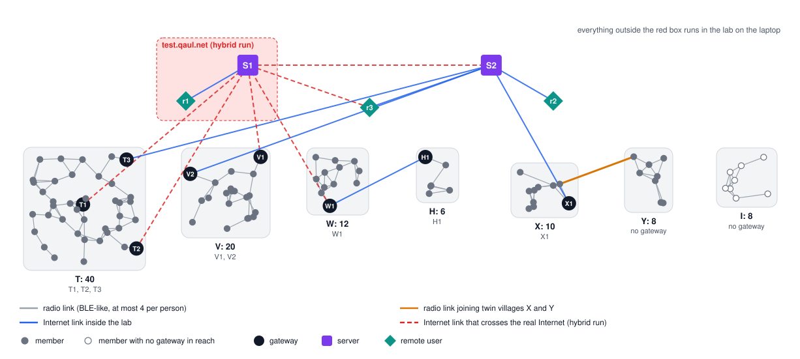

# router_v2 on a realistic world, over the real Internet: first results

**Date:** 2026-11-15
**Branch:** `test/v2-router`, in both the lab and the server binary
**Status:** every result here comes from one run per setup, except where
noted, so all of it is preliminary.
**Harness:** [`world/`](world/README.md).

---

## 1. The test world

### 1.1 Who is in it

109 qaul nodes: 107 run in a lab on the laptop, and 2 (S1 and r1) on
test.qaul.net.

| Group | Nodes | Gateways and their Internet links | Stands for |
|---|---|---|---|
| **S1** | 1 | server; peers T1, T2, V1, W1, r1, r3, S2 | the public qaul Community Node (it is not the actaul public node, we're just naming it like that to mirror v1 and for real world case scenarios) |
| **S2** | 1 | server; peers S1, T3, V2, X1, r2, r3 | a regional server |
| **Town T** | 40 | T1 (centre) → S1, T2 (edge) → S1, T3 (edge) → S2 | a town with Internet in several places |
| **Village V** | 20 | V1 → S1, V2 → S2 | a village using two different providers |
| **Village W** | 12 | W1 → S1, and a direct link to H1 | a village helping a neighbour get online |
| **Hamlet H** | 6 | H1 → W1 only | a hamlet whose only way out is W's gateway |
| **Twin X** | 10 | X1 → S2 | the twin village with Internet |
| **Twin Y** | 8 | none; one radio link joins it to X | the twin village without Internet |
| **Island I** | 8 | none | a village with no Internet at all |
| **r1** | 1 | S1 | a person abroad, next to the public server |
| **r2** | 1 | S2 | a person near the regional server |
| **r3** | 1 | S1 and S2 | a person with one far and one near connection |

Each community's gateways count toward its size; T has 37 members plus
3 gateways.

### 1.2 How it connects



*Drawn by `world/draw_world.py` from the generator's own files, so the radio
meshes are the real ones. Grey: radio links. Blue: Internet links inside the
lab. Red dashes: Internet links that cross the real Internet in the hybrid
run. The red box is what runs on test.qaul.net.*

There are three kinds of link:

1. **Radio links** inside a community stand in for Bluetooth or Wi-Fi
   between phones:
   - people are placed at random, and each links to whoever is in range,
     nearest first;
   - nobody has more than 4 links (the Bluetooth limit);
   - qaul sees these as its LAN transport.
2. **One radio bridge** joins the twin villages X and Y, so Y's people can
   reach X's gateway.
3. **Internet links** run between gateways, servers and remote users. qaul
   sees these as its INTERNET transport. In the hybrid run, six of them
   cross the real Internet: T1, T2, V1, W1, r3 and S2 to S1.

How the communities turn out:

| Community | People | Radio links | Links per person (max / mean) | Widest distance (radio hops) |
|---|---|---|---|---|
| T | 40 | 64 | 4 / 3.2 | 12 |
| V | 20 | 31 | 4 / 3.1 | 8 |
| W | 12 | 19 | 4 / 3.2 | 5 |
| H | 6 | 8 | 4 / 2.7 | 3 |
| X | 10 | 16 | 4 / 3.2 | 5 |
| Y | 8 | 12 | 4 / 3.0 | 3 |
| I | 8 | 12 | 4 / 3.0 | 5 |

The layout is fixed by a seed, so every run uses the same world.

### 1.3 The two layers qaul builds on top

qaul v2 keeps two separate "spheres" (spec §2.3):

```
   Local sphere T (radio)        Internet sphere             Local sphere V (radio)
   member ~~ member ~~ T3 =========== S2 =========== V2 ~~ member ~~ member
                       |                             |
                  a gateway sits in both: its own community and the Internet

   ~~  radio link: members know everyone in their own community, and its gateways
   ==  Internet link: gateways, servers and remote users hold the directory
```

- **A member never learns another community's users** (§2.3), which keeps a
  phone's routing state as small as its own village.
- **To be reachable from elsewhere,** a member registers with a nearby
  gateway (*delegation*, §10.3). The gateway lists the member in its
  *manifest*, and all the gateways' manifests together form the
  **directory**.
- **To reach someone elsewhere,** a member hands the message to its nearest
  gateway. That gateway finds the recipient's gateway in the directory and
  sends the message across the Internet sphere.

Communities that end up as one Local sphere:

| Sphere | Communities | Gateways |
|---|---|---|
| T | T | T1, T2, T3 |
| V | V | V1, V2 |
| W | W | W1 |
| H | H | H1 |
| X+Y | X and Y, joined by the radio bridge | X1 |
| I | I | none: its 8 people are reachable only from inside I |

That leaves **101 users reachable from anywhere** (everyone but I's 8), and
13 nodes holding the gateway role: the 8 community gateways, S1, S2, r1, r2
and r3.

### 1.4 Where it physically runs

```
 laptop: Windows -> WSL2 (Linux)                                    test.qaul.net (Hetzner)
 +---------------------------------------------------+              +--------------------------+
 | meshnet-lab: one network namespace per node       |              |  nft table qaul_hybrid:  |
 |                                                   |              |  UDP 9229 only from the  |
 |   member ~~~~~~ T1 ----+                          |   real       |  home address; no mDNS   |
 |   (radio, in the lab)  | egress link 198.18.0.x   |   Internet   |  out from qaul           |
 |                        v                          |   ~115-148ms |                          |
 |                  WSL host: NAT, only to the server -------------->  S1  qauld --port 9229   |
 |                        ^                          |   round trip |   |                      |
 |   T2, V1, W1, r3, S2 --+  (each its own link)     |              |   +- r1 (over loopback)  |
 |                                                   |              |                          |
 |   T3, V2, X1, r2 -- S2   (lab Internet links)     |              +--------------------------+
 +---------------------------------------------------+
```

- **Egress.** Only the six lab ends of far links get a way out, each over its
  own point-to-point link to the WSL host (`world/egress.sh`):
  - the only route over that link leads to the server;
  - the host drops everything else;
  - members have no way out at all.
- **The laptop can't accept connections from outside**, being behind Windows'
  and the home router's NAT. So the lab always dials S1, never the reverse.
- **On the server,** S1 and r1.
- **Every Internet link in the lab gets mDNS dropped** (`world/link_filter.sh`),
  so two gateways joined by such a link (W1 and H1) can't find each other over
  LAN and merge their communities.

### 1.5 How a message travels: three examples

```
far-0, stays in the lab (T.05 -> X.10):
  T.05 ~radio~> T3 --lab--> S2 --lab--> X1 ~radio~> X.10

far-2, out to the server and back (T.13 -> V.01):
  T.13 ~radio~> T1 ==Internet==> S1 ==Internet==> V1 ~radio~> V.01

transit, through another community's gateway (H.06 -> V.19):
  H.06 ~radio~> H1 --lab--> W1 ==Internet==> S1 ==Internet==> V1 ~radio~> V.19
```

## 2. Results: does the network form?

| Run (UTC) | Setup | All checks | Directories complete (after the dial) | Far-link ping time |
|---|---|---|---|---|
| 12 Nov 11:17 | half world, lab | passed | +127, +138, +148 s | 0.3–0.7 ms |
| 12 Nov 11:28 | full world, lab | passed | T1 +148 s, rest +188 / +198 s | 0.4–1.0 ms |
| 13 Nov 16:15 | half world, **real Internet** | passed | all +138 s | 120–141 ms |
| 14 Nov 11:17 | full world, **real Internet** | passed | T1 +141 s, rest +191 s | 115–148 ms |
| 14 Nov 12:22 | full world, **real Internet** | passed | T1 +158 s, rest +189 / +199 s | 118–142 ms |
| 15 Nov 08:00 | full world, lab, with messages | passed | +140 / +191 s | 1–2 ms |
| 15 Nov 08:14 | full world, **real Internet**, with messages | passed | +140 / +191 s | 113–130 ms |

**Why +140 s and +190 s.** A gateway publishes manifest updates at most every
60 s (§10.8). In the three full-world runs examined in detail (12 Nov lab,
14 Nov real Internet twice), the updates came at about +0, +60, +120 and
+180 s. Most members registered within the first
minute. But the Town's farthest members registered at +123 to +138 s, just
missing the +120 s update, so T1 only listed them at +183 s and every
directory waited for that. Those members are T.09 (7 radio hops from T1) and
sometimes T.01 (6 hops). The 115–148 ms of Internet delay never moved an
update or a registration across one of those boundaries.

**Other measurements from the full-world, real-Internet runs:**

| | 14 Nov 11:17 | 14 Nov 12:22 |
|---|---|---|
| Time for the far gateways to connect to S1 | 0.7–1.9 s | 0.4–1.0 s |
| Data each far gateway sent / received in the first ~200 s | 188–397 KB / 160–351 KB | 168–368 KB / 145–338 KB |
| Laptop → server ping, start → end of run | 118 → 118 ms | 120 → 133 ms (peak 212) |
| Profile fetches timed out in the first 190 s (lab-only run: 769) | 531 | 771 |
| ERROR log lines | 0 | 0 |

S2, the server-to-server link, carries the most data.

## 5. Results: do messages get through, and how fast?

`world/traffic.py` picks sender–recipient pairs by the path a message has to
take, 3 pairs per kind of path, 5 messages per pair.
- **Timing:** each message is timed from qaul's own records: the recipient
  stores the sender's `sent_at` and its own `received_at`. Both are lab nodes
  sharing one clock, so this is exact to the millisecond.

Median delivery time of later messages, 15 Nov:

| Path | Example | Lab | Real Internet | Added |
|---|---|---|---|---|
| inside one community | T.09 → T.12 | 142 ms | 102 ms | (normal variation) |
| across the twins' radio bridge | Y.01 → X.09 | 90 ms | 93 ms | – |
| between communities, staying in the lab | T.05 → X.10 | 130 ms | 137 ms | – |
| between communities, out to S1 and back | T.13 → V.01 | 166 ms | **480 ms** | **+314 ms** |
| H, through W1 and then S1 | H.06 → V.19 | 146 ms | **477 ms** | **+331 ms** |
| Y, through X1, S2 and S1 | Y.04 → T.16 | 145 ms | **482 ms** | **+337 ms** |
| to remote user r3, through S1 | T.32 → r3 | – | about 430 ms | – |
| to island I | T.08 → I.01 | not delivered (as expected) | not delivered (as expected) | |

Delivered: 105 of 105 messages in the lab and 100 of 100 over the real
Internet, where r1 can't take part.

What the numbers say:

1. **Each hop over the real Internet costs about 165 ms.** The server is
   119 ms away (round trip), so the data alone would take about 60 ms to get
   there. A hop costs about 1.4 round trips instead.
   - **Likely cause:** qaul opens and negotiates a new
     stream for every message, which costs a round trip before any data
     moves. This issue was what I diagnosed in our last call.
2. **Paths that stay in the lab don't change at all.**
3. **In the lab, about 100–200 ms is qaul's own handling,** since lab links
   take 0.5 ms. The first message of a pair is not much slower than the rest.
4. **A sender's exit depends only on which gateway is nearest to it** (section
   2.5). Example: T.32's nearest gateway is T2, so its message to r3 went out
   through S1 (about 430 ms), although r3 is also linked to S2 in the lab.
5. **When two gateways are equally near, the choice is arbitrary.** qaul keeps
   whichever it finds first. T.24 had T2 and T3 at the same cost and went via
   T3.

## 6. Results: failures

Section 6.1 has S1 going down, over the real Internet. Section 6.3 has a gateway losing its Internet.

### 6.1 S1 goes down, over the real Internet

**Run:** 17 Nov, 08:22 UTC: the directory was complete by +199 s, and no community leaked
users into another. Laptop to server: 111 ms round trip, no loss.

**What was done.** The same as in the lab, except for where the cut is
made. S1 and r1 run on test.qaul.net, and the six lab gateways that reach
S1 (S2, r3, T1, T2, V1, W1) do so through the laptop's egress. The cut
dropped all of their egress traffic, so S1 vanished from the lab's view, as
if the server or its network had died. S1 and r1 kept running and stayed
linked to each other on the server.

**What happened, against the lab runs:**

| | Lab (15 and 17 Nov) | Real Internet |
|---|---|---|
| Gateway role lost (logs) | +10 to +12 s | +12 to +13 s (T1, T2, V1) |
| S1's side | – | stopped sending to the six after +13 s; kept the gateway role through r1, as predicted, and so did r1 |
| Members register elsewhere | 37 of 40, then 40 of 40, by +35 s | 40 of 40 by +35 s; none stuck |
| T1 → T3 (fastest / median / slowest) | +25 / +25 / +30–35 s | 19 of 19: +20 / +25 / +35 s, **6 of them via T2** |
| T2 → T3 | +20–25 / +27.5–30 / +30 s, 6 via T1 | 7 of 7: +25 / +25 / +25 s, 6 via T1 |
| V1 → V2 | +20 / +25 / +25 s | 14 of 14: +20 / +25 / +25 s |
| New gateway's manifests | T3 +19/+79 s, +23/+83 s; V2 +13/+73 s, +18/+78 s | T3 +20 s (2 members), +80 s (24); V2 +19 s, +79 s |
| Links back after the restore | within 5–10 s | the six gateways dialled S1 again 6–9 s after the restore (S1's log); gateway role back at +7 s |
| After the restore | moved members stay | moved members stay (T3 38, V2 19) |

**Findings:** Everything ran as it is supposed to, following the spec.

### 6.3 T1 loses its Internet (real Interne)

**Run:** 17 Nov, 08:45 UTC. The world formed
correctly first, with the directory complete by +198 s. Laptop to server:
116 ms round trip, no loss.

**What was done.** T1's link to S1 is its only Internet. All of T1's egress
traffic was dropped for 20 s, as if its mobile data dropped out. It then got
150 s back, lost it again for 90 s, and got 180 s more. Times below are
after the first cut. Four probe pairs from X sent a message every 10 s: three
to T1's members, and one to a member on T3 as a control.

### 6.4 People walk away and come back (real Internet)

**Run:** 19 Nov, 10:06 UTC

**What was done.** 9 members, 10% of those with a gateway, were cut off
from everyone at once for 150 s, then let back and watched for 235 s:
T.11, T.18, T.20, T.36, W.04, W.07, W.10, X.02 and Y.04. Their daemons kept
running, as a phone does when its owner walks out of range. Times below
are after they left; "R+" is after they came back. Five probe pairs from X
sent a message every 10 s to five of the walkers, and one went to a V member
as a control.

**What happened, against the predictions:**

| Predicted | Measured |
|---|---|
| Their gateways drop them within about 95 s (§10.7) | Yes: at +85.5 to +90.6 s |
| On return they register with a gateway again (§10.3) | Yes: all 9 within 10 s. Three chose a different gateway: T.18 and T.36 went from T3 to T1, T.20 from T1 to T3 |
| (not predicted) Their radio links come back | Every broken link but one came back 0–3 s after the return. The link between T.18 and T.36 never did |

**Probe messages:**

| Pair | Lost after the return | Reachable again | Delay (median), before → after |
|---|---|---|---|
| X.07 → T.11 (T1, both times) | 1 | R+10 s | 0.47 → 0.50 s |
| X.01 → T.20 (T1 → T3) | 1 | R+10 s | 0.47 → 0.06 s |
| X.02 → T.18 (T3 → T1) | 7 | R+70 s | 0.09 → 0.51 s |
| X.07 → T.36 (T3 → T1) | 7 | R+70 s | 0.08 → 0.49 s |
| X.09 → W.04 (W1, both times) | 7 | R+70 s | 0.45 → 0.48 s |
| X.04 → V.05 (control) | 0 | – | 0.07 → 0.08 s |

Every message to a walker was lost while they were away, as expected. X.02
was itself one of the walkers. T1 and W1 reach the world through S1, so
their members' messages cross the real Internet twice, about 0.5 s against
0.07–0.09 s through T3. That is why T.18's and T.36's delays rose and
T.20's fell.