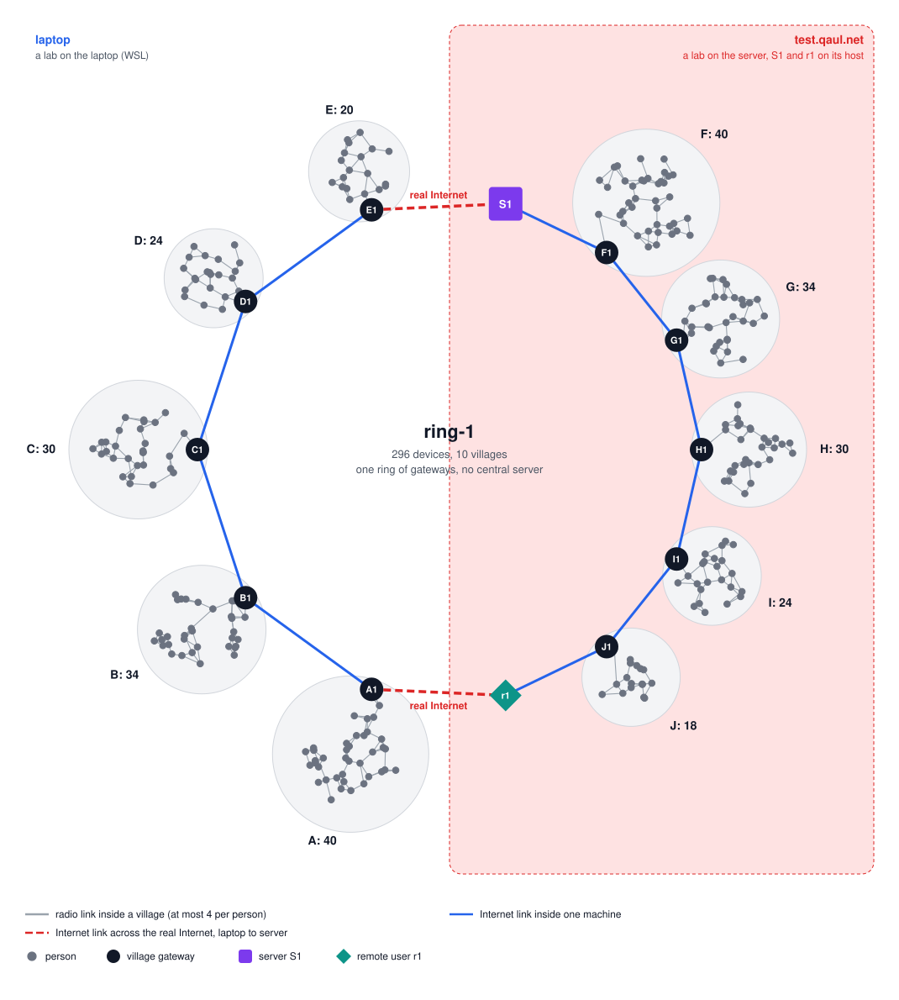
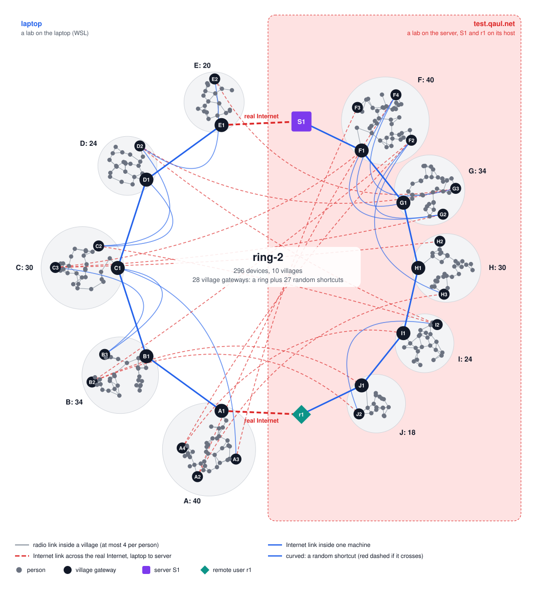

# Ring network tests

Two networks, one run each: ring-1 on 24 November 2026 and ring-2 on
25 November. qaul router v2, branch `test/v2-router`, with three fixes not yet
merged.

## Ring-1: one gateway per village

### The network

Ten villages with 296 devices between them. Each village has one device with
Internet access, its gateway. The gateways are joined in a ring: each one is
connected to the next village's gateway, and the last one back to the first.
There is no central server.

Half the ring runs in a lab on a laptop, the other half in a lab on our server,
test.qaul.net. The ring crosses the real Internet twice, through two relay
nodes on the server, S1 and r1.

| Village | A | B | C | D | E | F | G | H | I | J |
|---|---|---|---|---|---|---|---|---|---|---|
| Devices | 40 | 34 | 30 | 24 | 20 | 40 | 34 | 30 | 24 | 18 |
| Runs on | laptop | laptop | laptop | laptop | laptop | server | server | server | server | server |

Inside a village, devices are linked by local radio, at most 4 neighbours each.
The two Internet crossings measured 170 and 190 ms round trip.

### Network formation

| | |
|---|---|
| Ring links up | 12 of 12 |
| Devices registered with their village's gateway | 284 of 284 |
| Gateways that learned all 296 users | 10 of 10 |
| Time for a gateway to learn all 296 users | 5 min 12 s (first gateway) to 6 min 43 s (last) after the ring was switched on |
| Village-only information seen in another village | none (note 4) |
| Data over the two Internet crossings | about 4.6 MB in the first 6.5 minutes |

For comparison, the star-shaped network tested earlier (107 devices around two
servers) took about 3 min 20 s.

### Messages

100 messages: 5 each between 20 pairs of people, from two people in the same
village up to the opposite side of the ring, 6 villages away. All 100 arrived,
96 of them within a second.

| Sender and recipient | Arrived | Typical time | Slowest |
|---|---|---|---|
| both on the laptop | 25 of 25 | 0.17 s | 0.26 s |
| both on the server | 25 of 25 | 0.50 s | 4.1 s |
| laptop to server, across the Internet | 25 of 25 | 0.46 s | 0.83 s |
| server to laptop, across the Internet | 25 of 25 | 0.67 s | 1.14 s |

How far apart two villages are on the ring mattered little. A message to the
opposite side, 6 villages away, took 0.45 to 0.67 s, about the same as one
across the Internet to a village 2 away (0.43 to 0.66 s). On the laptop alone,
going up to 4 villages along added at most about 0.1 s over a message inside
one village.

### Notes

1. The server half was slower than the laptop half. A message inside one
   village, over the same number of radio hops, took 0.44 s on the server and
   0.11 s on the laptop. The software is the same and the processors are
   similar, so the cause is still open. It also pushes up every time above
   that involves the server.
2. Times between the laptop and the server are corrected for the difference
   between the two machines' clocks, which was 0.1 s during the run and
   measured to within about 0.06 s. Even allowing for that, messages from the
   server to the laptop were slower than the other way.
3. Two messages inside the server half, both from the same pair, took 2.3 s
   and 4.1 s. Every other message took under 1.2 s.
4. The server's check flagged 16 people as knowing someone outside their
   village. All 16 were partners in the message test, which had already
   started while that check was still running, and joining a chat makes two
   people known to each other. The laptop's check, done before any message
   was sent, found none. The test now waits for both checks before sending.
5. This is a single run. The figures need a repeat before they are relied on.

## Ring-2: more gateways, random shortcuts

Same 296 devices in the same villages, with the same radio links. Each village
now has 2 to 4 gateways, by size: 28 instead of 10. The ring from ring-1 is
kept, and every extra gateway got one or two links to gateways in other
villages, picked at random: 27 shortcuts. 15 of them join the laptop straight
to the server, so the network now crosses the real Internet 17 times instead
of twice.

| Village | A | B | C | D | E | F | G | H | I | J |
|---|---|---|---|---|---|---|---|---|---|---|
| Gateways | 4 | 3 | 3 | 2 | 2 | 4 | 3 | 3 | 2 | 2 |

### Network formation

| | Ring-1 | Ring-2 |
|---|---|---|
| Internet links up | 12 of 12 | 39 of 39 |
| Devices registered with a gateway of their village | 284 of 284 | 266 of 266 |
| Gateways that learned all 296 users | 10 of 10 | 28 of 28 |
| Time for a gateway to learn all 296 users | 5 min 12 s to 6 min 43 s | 3 min 31 s to 5 min 24 s |
| Village-only information seen in another village | none | none |
| Data over the real Internet in the first 6 minutes or so | about 4.6 MB | about 24 MB |

More gateways and shortcuts made the network form about a minute and a half
faster, with nothing missing.

### Messages

The same 20 pairs of people as ring-1, 5 messages each. One person in ring-1's
pairs is a gateway in ring-2, so a neighbour from the same village stood in.
All 100 messages arrived, 89 of them within a second (ring-1: 96).

| Sender and recipient | Ring-1 typical | Ring-2 typical | Ring-2 slowest |
|---|---|---|---|
| both on the laptop | 0.17 s | 0.12 s | 1.19 s |
| both on the server | 0.50 s | 0.65 s | 1.21 s |
| laptop to server | 0.46 s | 0.38 s | 1.06 s |
| server to laptop | 0.67 s | 0.67 s | 1.10 s |

The shortcuts made some messages much faster and others slower. What decided
it was how many times the message's route crossed the real Internet, not how
many villages it passed:

| Times the route crosses the real Internet | Pairs | Typical time |
|---|---|---|
| 0 | 5 | 0.12 s |
| 1 | 7 | 0.56 s |
| 2 | 4 | 0.73 s |
| 3 | 2 | 0.96 s |
| 4 | 1 | 1.02 s |

One more pair had two equally short routes, crossing once or three times, and
took 0.38 s.

qaul picks the route with the fewest hops, and a hop across the Internet
counts the same as a hop inside the lab. With random shortcuts, the shortest
route often goes out to the server and back. A message between villages A
and D, both on the laptop and three apart on the ring, took 0.23 s in ring-1.
In ring-2 the shortest route between the two people's gateways crosses the
real Internet four times, and the messages took 1.02 s.

### Notes

1. The routes above come from the network map: the shortest path between the
   two people's gateways. They were not traced message by message.
2. The server half was again slower than the laptop half (0.65 s for messages
   that stayed on the server, 0.12 s on the laptop).
3. The clock difference between the two machines was 0.21 s this time,
   measured to within about 0.06 s, and is taken off the cross-machine times.
4. The leak check from note 4 above was fixed for this run: the messages
   waited until both checks had finished, and both found nothing.
5. One run. The random shortcuts are one draw; another draw would give
   different routes.

Not covered here: what happens when a link in the ring breaks.